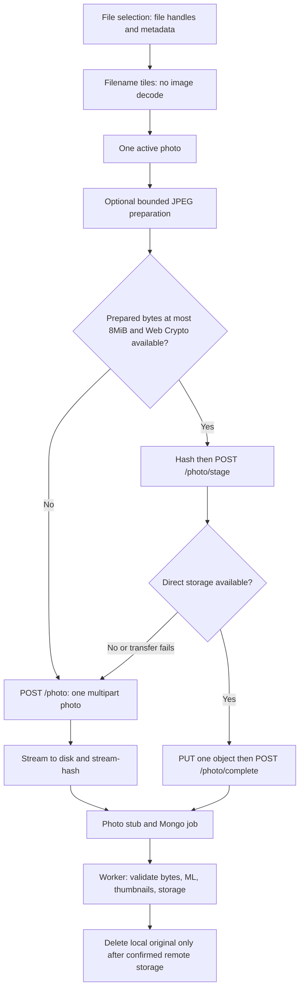

# Upload architecture and memory review

## Scope

Reviewed the browser queue, image preparation, hashing, direct PUT and multipart paths,
pause/resume/cancel, navigation, disk staging, Mongo jobs, ingest workers, and FTP ingress.
The changes prioritize bounded client working memory over maximum upload concurrency.

## Findings and fixes

| Severity | Location | Finding | Applied fix |
|---|---|---|---|
| High | `Upload_Img.tsx` | Three workers could retain three 75MiB multipart batches plus prepared blobs; prepared blobs accumulated across the album. | One photo per request, one worker; release prepared blobs after each successful file and on terminal cleanup. |
| High | `Upload_Img.tsx` preview tiles | Twelve original-resolution image decodes are not a small RAM bound. A 6000×4000 RGBA surface alone is about 92MiB. | Filename/icon tiles, no original image decoding or object URLs. At most twelve visible file tiles. |
| High | `clientImage.ts` | Recompression decoded arbitrary-resolution originals and allocated a second canvas surface. | Inspect at most 64KiB of JPEG headers first; only recompress known JPEGs up to 4,194,304 pixels and an 8192px edge. Other inputs retain original bytes. Close bitmaps and zero canvas dimensions. |
| Medium | `fileHasher.sha256Hex` | Web Crypto requires an entire file-sized ArrayBuffer, even for 50MiB originals. | Above 8MiB, use multipart instead; the server hashes its disk stream. Smaller prepared files can use direct PUT. |
| Medium | `handleUpload` / `uploadSession.ts` | The UI displayed completed batches, so one active batch stayed at zero. Replacing per-file fractions with per-batch fractions also changed the inferred total file count. | Show acknowledged photos out of a stable total; cap progress at 99% until acknowledgement. Store totals separately and remove redundant fraction copies from session snapshots. |
| High | Upload scheduling | Pause was not checked after asynchronous preparation/staging or before multipart attempts, including zero-delay retries. | Gate each new preparation/transfer/retry; finish the current transfer and its completion acknowledgement. Finish the session if the final photo completes while paused. |
| High | Session cancellation | Clearing the active controller immediately allowed a new upload to race the old worker's cleanup. Another event could overwrite the singleton session. | Keep ownership until the aborted worker finishes; reject another event's upload while one is active. |
| High | `middleware/upload.ts` / `/photo` | Interrupted multipart transfers and rejected metadata could leave temporary originals behind. | Disk streaming with backpressure and abort cleanup; clean received files on metadata rejection; settle per-file staging errors independently. |
| High | Multipart fallback / Mongo queue | A failed direct-upload stub could cause fallback bytes to be discarded; exhausted attempts remained exhausted after explicit retry. | Queued stubs adopt fallback bytes; surface rename failures; reset retry budgets on explicit retries/reuploads. |
| High | `getObjectBytes` / ingest worker | Direct-upload bytes were buffered before enforcing a limit and the client's claimed hash was not checked before ML indexing. | Reject declared or streamed objects above 50MiB; destroy response streams; verify actual SHA-256 before ML/FAISS. |
| High | `finishItem` / `processUploadedFile` | Drive helpers can return without storing anything, but callers deleted the only local original. | Delete local bytes only after object-store success or a confirmed `Photo.driveFileId`. |
| Medium | Queue / FTP watcher | Incomplete direct PUTs could repeatedly reclaim the oldest queue slots; FTP started unbounded ingestion promises. | Released jobs yield by update time; FTP permits two active ingestions per process and leaves excess files on disk. |
| Medium | `getPresignedPut` | Invalid keys bypassed validation when storage was unconfigured. | Validate before the unconfigured-storage return; existing contract tests cover invalid keys. |

## Data flow



An upload acknowledgement means bytes were accepted and indexing was queued, not that ML
or every remote mirror has finished. Completed photos leave the browser queue immediately;
failed and unsent photos remain available for retry.

## Pause, cancellation, and navigation contract

- Pause prevents new photos and transfer attempts from starting. One already-running
  transfer may finish; its completion acknowledgement is allowed so accepted bytes are not stranded.
- Resume continues the same in-memory queue. Retry backoff stops advancing while paused.
- Cancel aborts the active request and prevents new work. It does not undo photos already
  accepted by the server or stop their queued ML jobs.
- In-app navigation preserves the running upload; returning to the same event reattaches
  Pause/Resume/Cancel and progress. Another event cannot start a competing singleton queue.
- Refresh, browser termination, or OS suspension can interrupt the in-memory queue.
  There is no durable browser queue or resumable multipart/chunk protocol. Retries send the
  current photo again; server content hashes handle deduplication.

## Resource bounds and tradeoffs

| Resource | Current bound or behavior |
|---|---|
| Browser transfers | One active photo, maximum 50MiB input. Browser networking buffers remain implementation-dependent. |
| Browser hashing | Whole-file hashing only up to 8MiB of prepared bytes. |
| Browser image surfaces | Optional recompression only up to 4MP: approximately 16MiB per RGBA surface, plus browser decoder/encoder overhead. No preview surfaces. |
| Album bookkeeping | File handles and metadata still scale with selected file count; this is not a total constant-RAM guarantee. Prepared image bytes do not accumulate across successful files. |
| Photo quality | Large, unsupported, or uncertain images upload unchanged. Eligible JPEGs retain quality 0.97 without downscaling; the original-quality setting still bypasses recompression. |
| Multipart ingress | Disk-backed streaming; at most 100 files, 32 fields, 132 parts, and 50MiB per file. The dashboard sends one file per request. Other callers can still stage up to 5,000MiB in one request. |
| Worker source buffers | At most two claimed jobs per tick per API process: up to 100MiB of source buffers, plus concatenation, HTTP, ML, and thumbnail overhead. Not a fully streaming ingest worker. |
| FTP | Two active ingestions per process. Process counts multiply this ceiling. |
| Server-wide admission | No global upload concurrency/disk-quota ceiling; multiple clients and PM2 workers multiply resource use. The reverse proxy's existing request-size limits remain relevant. |
| Storage failure | Preserve local originals when mirroring is unconfirmed. Disk monitoring remains necessary; this change does not add a reconciliation service. |

The earlier documentation's claim that twelve original previews fit below 50MB was incorrect.
No fixed browser RAM limit is promised: real devices, image codecs, and browser-native buffers vary.
One worker trades some high-bandwidth throughput for predictable client working memory.

## Verification

- Frontend upload, compression, image preparation, and session suites: 62 tests passed
  across the final affected runs. Covers pause during preparation, paused final completion,
  sequential preparation, stable counts, cancellation ownership, retries, file limits,
  retained queue entries, image cleanup, and oversized-image/hash pass-through.
- Frontend TypeScript check passed. An isolated webpack bundle of the actual uploader compiled.
- Backend TypeScript build and syntax checks passed. Upload safety/object-read/branching checks
  passed; existing presign tests passed after validation ordering was corrected.
- Browser smoke: actual uploader component, synthetic files, isolated acknowledgement server;
  mobile pause reached `1 of 6`, no subsequent photo started while paused, resume completed
  all six, and no original image elements were mounted. No horizontal overflow at widths
  320, 375, 768, 1024, 1440, and 2560.
- Verification used an isolated VPS checkout because local dependency/runtime startup was
  incomplete. The production checkout and API processes were not deployed or restarted for this review.
- CRA/Babel, Browserslist, React test `act`, and Node deprecation warnings remain outside this upload fix.
- No physical low-RAM phone or browser-native peak-RSS measurement was available. These checks
  verify resource bounds and behavior, not an exact mobile memory usage figure.

Run the focused checks:

```bash
cd front-end
npm test -- --watchAll=false --runInBand --runTestsByPath \
  src/component/dashboard/__tests__/Upload_Img.test.tsx \
  src/component/dashboard/__tests__/Upload_Img.compress.test.tsx \
  src/component/dashboard/__tests__/clientImage.test.ts \
  src/utils/__tests__/uploadSession.test.ts
npx tsc --noEmit
cd ../node-server-1
npm run build
node --test dist/photos/__tests__/uploadSafety.test.js \
  dist/photos/__tests__/objectReadLimit.test.js \
  dist/photos/__tests__/directPresign.test.js \
  dist/photos/__tests__/uploadBranching.test.js
```

